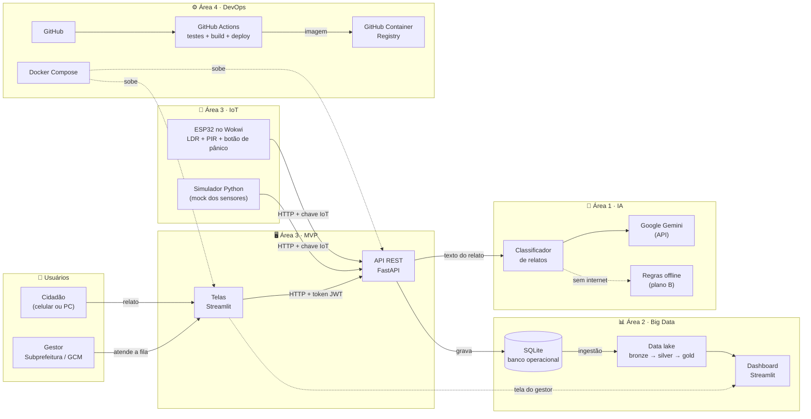

# Arquitetura do VigIA

O diagrama abaixo usa Mermaid e aparece desenhado automaticamente no GitHub. Para colocar no PDF:
abra <https://mermaid.live>, cole o código e exporte como PNG.

## Como as áreas se conectam

| De → Para | O que passa | Por quê |
|---|---|---|
| Telas → API | Relatos, login, mudança de status | As telas não acessam o banco direto: toda regra fica na API |
| Postes → API | Luz, presença e pânico | Sensores viram ocorrências automaticamente (pânico = urgência alta, luz apagada = iluminação) |
| API → IA | Texto do relato | Cada relato chega na fila já com categoria e urgência |
| API → Banco | Usuários, ocorrências, leituras | Fonte única dos dados |
| Banco → Data lake → Dashboard | Ocorrências e leituras | Os dados da IA e dos sensores alimentam o dashboard, que fica dentro do próprio app |
| GitHub → Actions → Registry | Cada commit | Testes, build e publicação da imagem rodam sozinhos a cada mudança |

## Tecnologias

| Camada | Tecnologia |
|---|---|
| Interface | Streamlit (Python) |
| API | FastAPI + Pydantic |
| Banco | SQLite |
| Segurança | bcrypt (senhas), JWT (sessão), chave de API (dispositivos) |
| IA | Google Gemini (`google-genai`) + regras de palavras-chave |
| IoT | ESP32 simulado no Wokwi + simulador em Python |
| Dados | pandas (pipeline e funções analíticas) + Altair (gráficos) |
| DevOps | Git/GitHub, GitHub Actions, Docker Compose, pytest |
